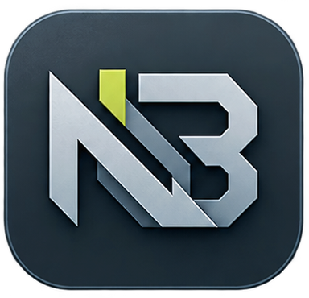

# Net Bat Launcher 2142

[English](https://github.com/VordyV/NetBatLauncher/blob/master/Readme.md)
:arrow_right:[Русский](https://github.com/VordyV/NetBatLauncher/blob/master/Readme_ru.md)

## Введение

**NBL2142** - это бесплатный игровой лаунчер для простой и приятной игры в **Battlefield 2142**. Главная цель проекта - предоставить достаточно удобный инструмент как для запуска самой игры, так и для управления ресурсами.

## Что умеет?

- :arrows_counterclockwise: Автоматически обновляться при выходе новой версии. Пользователю будет предложено выполнить обновление, если его версия лаунчера устареет;
- :computer: Запуск на разных платформах, **NovGames** или **Respy** и других;
- :earth_asia: Поддержка нескольких языков.

## Поддерживаемые платформы

- Windows 10/11 - x64

## Как скачать?

Вы можете скачать актуальную версию в разделе [Релизы](https://github.com/VordyV/NetBatLauncher/releases) на GitHub.

> [!WARNING]
> Это единственный источник на данный момент; если вам предлагают скачать из другого места - делайте это на свой страх и риск, мы точно не знаем, какой код может быть в exe-файлах этой конкретной версии.

---

Net Bat Launcher 2142 - это некоммерческий проект, созданный фанатами. Проект не связан с GameSpy, Digital Illusions CE или Electronic Arts и не одобрен ими. Все товарные знаки и авторские права принадлежат их соответствующим владельцам.
